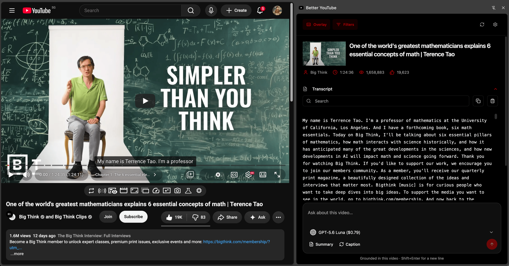
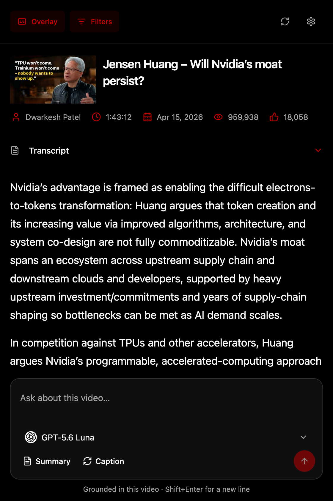
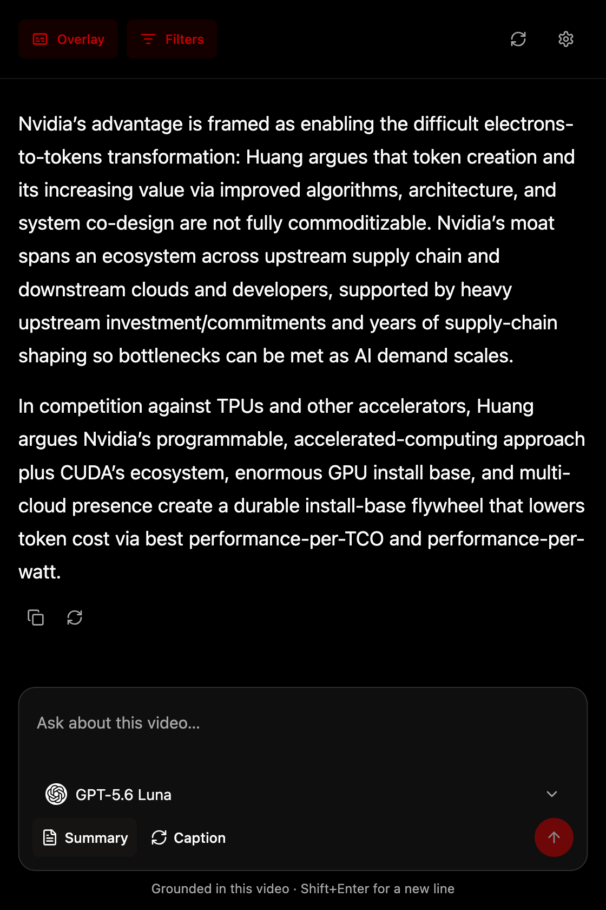
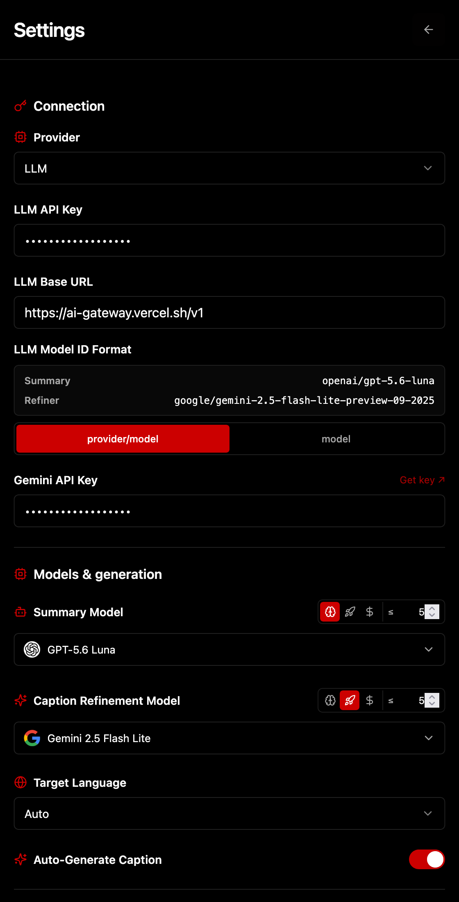
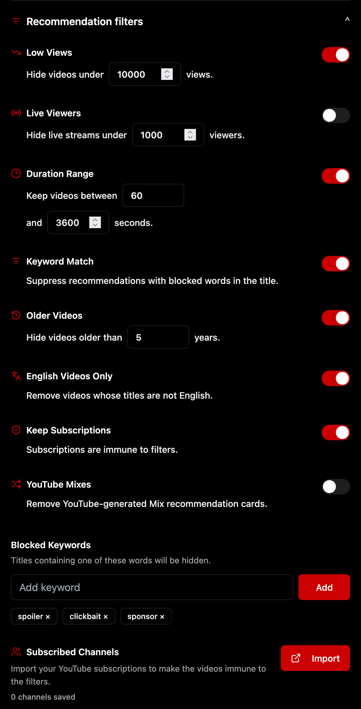
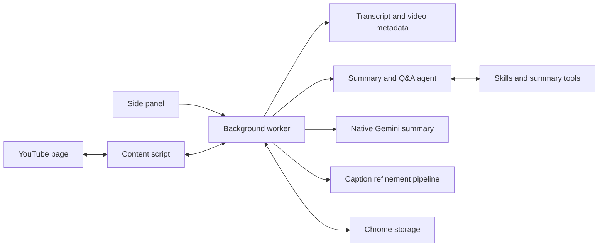
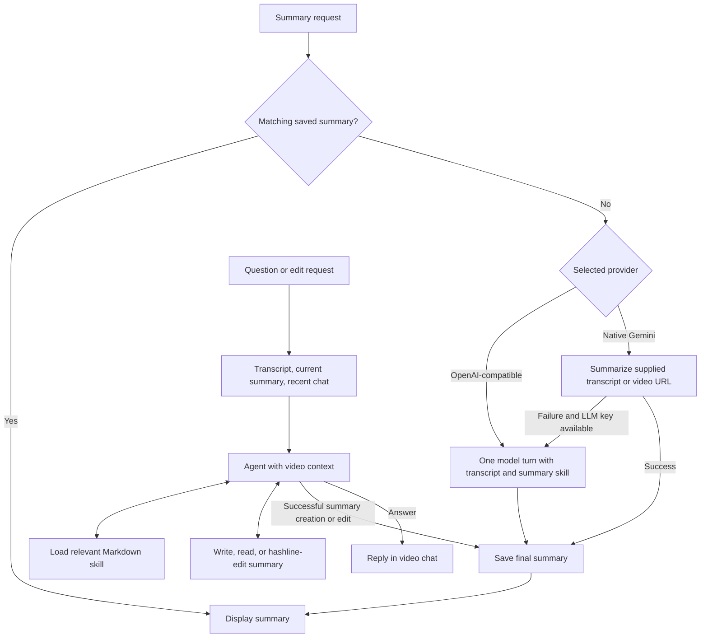
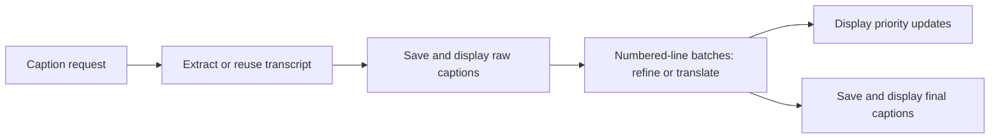
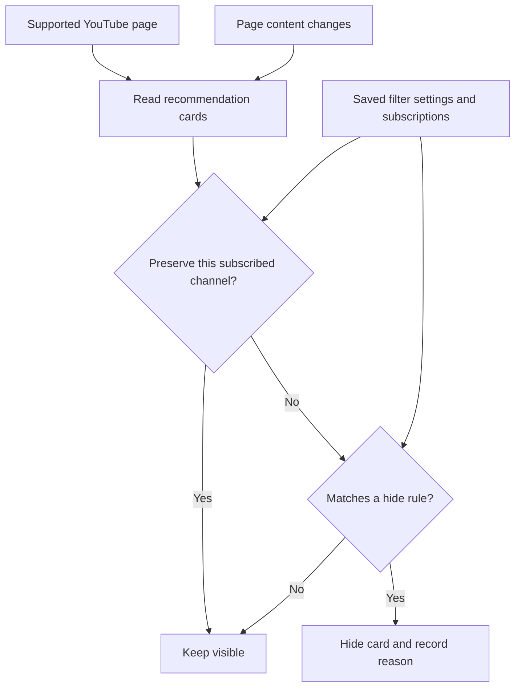

# Better YouTube

Chrome MV3 extension for YouTube transcript extraction, caption refinement, grounded AI summaries, and recommendation filtering.



<p align="center">
  
  
</p>
<p align="center">
  
  
</p>

## Installation

Download `better-youtube-<version>.zip` from [Releases](https://github.com/teron131/better-youtube/releases) when a packaged release is available.
Choose the extension ZIP under **Assets**, not GitHub's automatic source-code archives.

1. Extract the ZIP into a folder you intend to keep.
2. Open `chrome://extensions` and enable **Developer mode**.
3. Click **Load unpacked** and select the extracted folder containing `manifest.json`.
4. Open a YouTube video and click the extension icon to open the side panel.
5. Open Settings and configure your API key and model.

For updates, extract the new ZIP into the same folder and click **Reload** on the extension's card in `chrome://extensions`.
Until the first packaged release is published, build from source using the commands below and load the resulting `dist/` folder instead.

## What It Does

- Extracts transcript and video metadata from the active YouTube watch tab.
- Refines subtitle segments in the background and streams partial caption updates back to the player.
- Generates video summaries with Gemini or an OpenAI-compatible provider.
- Uses an OpenAI Agents SDK video assistant for OpenAI-compatible summaries, follow-up questions, and summary edits.
- Caches transcripts, subtitles, metadata, and summaries in Chrome storage.
- Filters recommendation feeds with saved rules such as views, duration, age, keywords, and subscription preservation.

In **Settings → Reading**, use **−** and **+** to adjust captions and summary/chat text independently in 10% steps from 50% to 200%.
The percentage button resets that setting to its 100% default.
Existing S/M/L preferences migrate to the nearest percentage scale; the default appearance stays the same.

## Transcript Sources

Better YouTube reads captions from the video open in your browser, using the existing YouTube session.
Open **Caption** or expand **Transcript** to choose a caption track by language and source (**Manual** or **Auto**).
**English · Translation** is available for any non-English source, including videos without a native English track.
The extension tries YouTube translation first where supported; if it is unavailable, click the translate icon, then **Confirm** to translate the selected source into English with the configured caption model.
Source text awaiting AI translation is not displayed or copied as completed English captions.
The existing default priority is English auto-generated, English manual, other auto-generated languages, then other manual languages.
Choosing a track loads it for the overlay, transcript search, and both copy actions without starting refinement.
When captions are enabled, the watch page also attempts to load the original captions without opening the side panel.
Choosing an English option that needs AI translation prepares the source without calling the caption model until confirmation.
Standalone fetchers can run into anti-bot checks, while Gemini's direct YouTube support has been unreliable on long videos in our testing.

| Approach | How it works | Trade-off |
| --- | --- | --- |
| **Active YouTube tab — default** | Reads captions from the watch page in your current browser session. | Avoids a separate fetcher's anti-bot hurdles, but requires the video to be open and captions to be available. |
| **Local fetching tools** | Uses tools such as yt-dlp to retrieve captions or download audio; FFmpeg handles audio conversion when speech-to-text is needed. | Requires local tools and potentially a transcription model or service. YouTube may block or rate-limit the download requests. |
| **Paid transcript API** | Sends the video URL to a hosted service that handles retrieval or transcription. | Avoids maintaining local fetching tools, but adds API costs, quotas, and dependence on the provider's coverage and reliability. |
| **Gemini native video input** | Sends the YouTube URL directly to Gemini for analysis. | Can use both audio and visuals, but in our testing, videos around an hour or longer have sometimes failed silently, returning no usable summary. |

The long-video caveat applies to Gemini's direct URL input; it is an observed reliability issue, not a fixed duration limit for transcript-based summaries.
Follow-up chat requires a transcript and a configured OpenAI-compatible API key.

## How It Works



### Summaries and Q&A

Initial summaries use the preloaded summary skill and return Markdown in one model turn.
Follow-up questions and requested edits use the agent with video context, Markdown skills, and hashline tools.
Summaries are Markdown text rendered like assistant messages; there is no required overview or chapter schema.
Only successful runs save summary changes; temporary tool history is discarded.



### Caption Rewriting

The transcript keeps each caption's timestamp in a separate column and highlights the current video caption.
Drag the vertical rail or use its arrow keys to browse without seeking; click a timestamp to seek the active video without changing its paused or playing state.
Search and copying use the caption text, and live playback tracking stops when the transcript is closed.
Caption rewriting runs independently of the agent and processes batches of 20 caption lines concurrently.
Each request numbers its lines with IDs such as `[LINE3]`, shows four neighbouring lines on each side as context, and lists the names the transcript repeats so the model spells them consistently; each reply line comes back under its ID and keeps that line's timestamps.
A reply that leaves out an ID is read as the model merging that line into its neighbour, so the merged caption spans both lines' times; a cleanup keeps the original line wherever the reply is too unlike it to be a correction.
Rewriting runs the caption model over the selected track with one of three options: **Refine in the same language** fixes typos, punctuation, and filler; **Translate to English** uses the model instead of YouTube's own translation; and **Translate to…** takes any language you type, such as `Japanese`, which reaches the model as written.
Click the wand icon beside the selected track, choose the option, then **Rewrite**; the option starts as a translation into the **Target language** setting when that differs from the track's language, and as **Refine** otherwise.
A translation batch that returns nothing after three attempts fails the run rather than substituting untranslated source text.
These checks enforce output structure; wording and faithful alignment with the source still depend on the selected caption model.
The separate **Auto-generate captions** setting remains opt-in and uses the saved track selection when available.
Generating a summary does not start caption refinement unless automatic generation is enabled.



### Recommendation Filtering



## Development

```bash
pnpm install
pnpm run dev
pnpm run build
```

Useful extra commands:

```bash
pnpm run lint
pnpm run test:chrome-tab
```

For a layout preview, run `pnpm dev` and open `/sidepanel.html?example=1`.
Real video processing requires the installed extension and a configured API key.

## Packaging and Releases

Run `pnpm run package` to build the extension and create a ZIP with its SHA-256 checksum in `.cache/releases/`.
Packaging requires the `zip` and `unzip` commands and includes the built extension without source maps.

Pushing a new version to `main` automatically checks the code, builds the extension ZIP, creates an annotated `v<version>` tag, and publishes the ZIP and checksum as GitHub Release assets.
Set matching versions in `package.json` and `public/manifest.json` before pushing; pushes whose package version is already tagged skip release creation.
Explicit `v<version>` tag pushes remain supported, and the tag must match the package and extension manifest versions.

## Build Output

`pnpm run build` produces:

- `dist/sidepanel.html` and the React side panel bundle
- `dist/background.js` for the MV3 service worker
- `dist/content.js` and `dist/assets/subtitles.css` for the YouTube page integration
