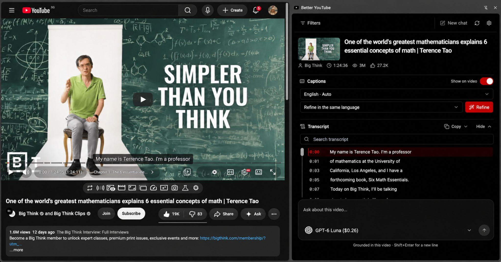
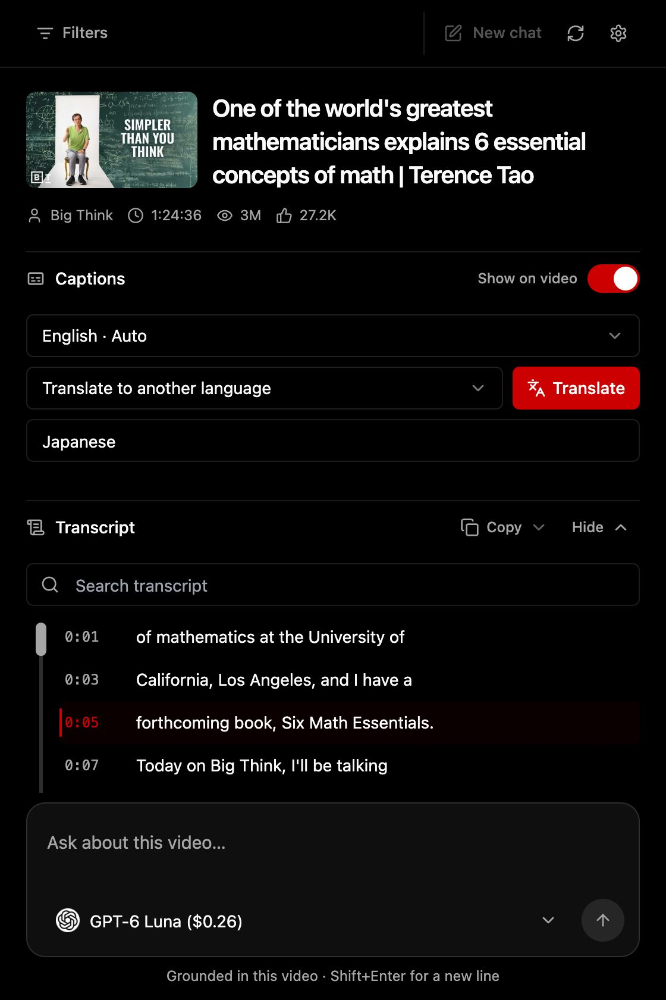
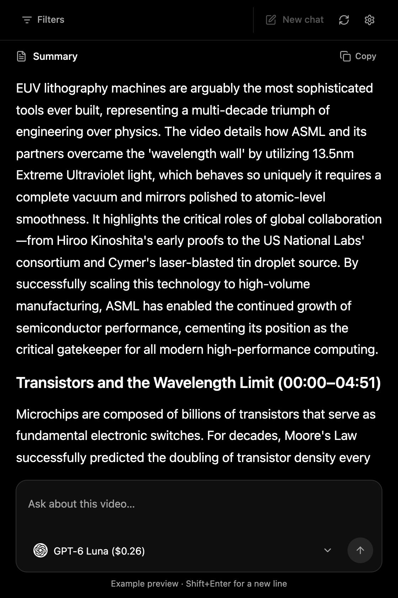
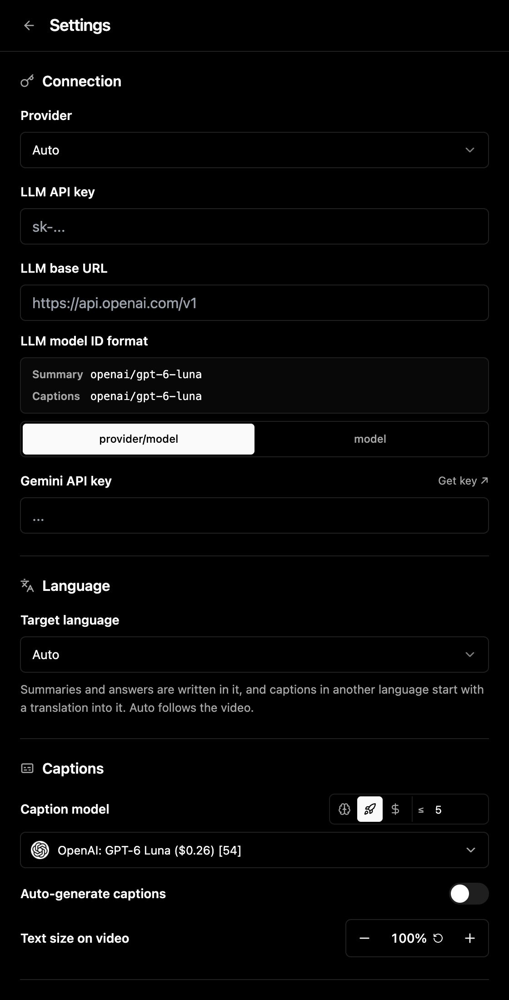
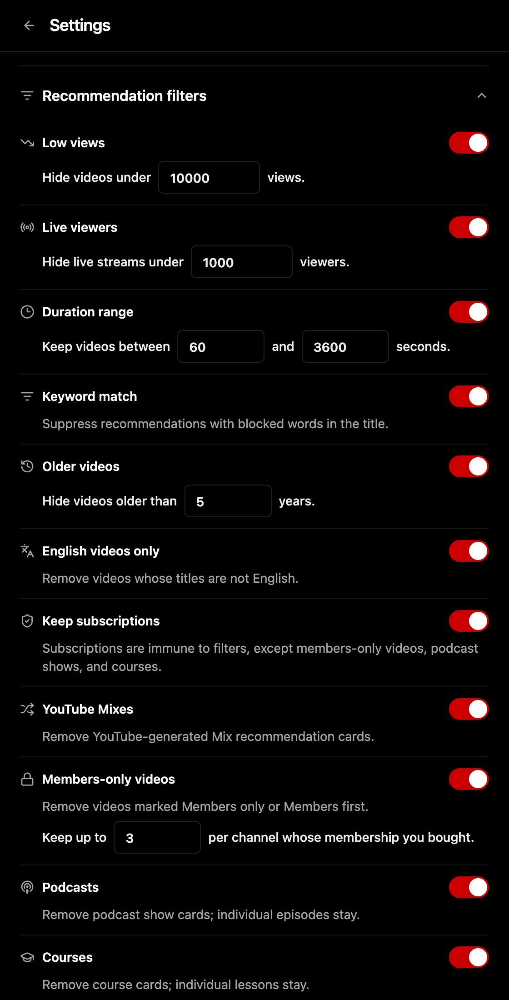

# Better YouTube

<h3 align="center">Fix, translate, and summarize the YouTube video you're watching.</h3>

Better YouTube is a Chrome side panel for YouTube. Open a video and it reads the captions already on the page: **Refine** cleans them up and **Translate** puts them into English or any language you type, right on the video, while **Transcript** lets you search, copy, and jump to any line. **Summarize** writes a Markdown summary and the chat box answers questions grounded in the transcript, on your own OpenAI-compatible or Gemini key. On recommendation feeds, **Filters** hides videos by views, length, age, keywords, and more, and keeps your subscriptions.



<p align="center">
  
  
</p>
<p align="center">
  
  
</p>

## How It Works


Red is the transcript and white is what the models send back.
Reading the captions from your own browser session means no separate fetcher for YouTube's bot checks to block; the video only has to be open and have captions.
Choosing a track loads it for the overlay, the transcript, and copying without calling any model.

- Each caption request carries four lines of context on each side of its 20, and timestamps never leave the extension: a reply line takes the times of the ID it comes back under.
- A missing ID is read as the model merging that line into its neighbour, so the merged caption spans both; a cleanup too unlike its source keeps the original line.
- A translation batch that returns nothing after three attempts fails the run instead of showing untranslated text.
- The rewrite option starts as a translation into **Target language** when that differs from the track's language, and as **Refine** otherwise.
- For a non-English video the track list also offers **English · Translation**, YouTube's own translation; when YouTube can't provide it, **Translate** fills it in with the caption model.
- **Auto-generate captions** is off by default; when on, it starts a caption run on the saved track as a video opens.
- Transcripts, captions, and summaries are cached per video in Chrome storage, so a reopened video shows them again without another model call.

## What It Costs

The extension is free, and captions and the transcript need no key.
**Refine** and **Translate** run the caption model over every line of the video, and each summary or answer runs the summary and chat model, billed by your provider.
The **≤** box beside each model picker hides models priced above it, and the sort buttons rank the rest by intelligence, speed, or price.

## What Leaves Your Browser

- When you press **Refine**, **Translate**, or **Summarize**, or send a question, the captions, video title and description, your question, and recent chat go to the provider you set: the **LLM base URL** or Gemini.
- A Gemini summary of a video whose transcript hasn't loaded sends the video's YouTube URL instead.
- Model prices and scores for the pickers are read from OpenRouter, Artificial Analysis, Vals, Epoch AI, and Surge AI; those requests carry no video data or keys.
- Keys, settings, your subscription list from `youtube.com/feed/channels`, and cached results stay in Chrome's local extension storage.

## Install

You need Google Chrome with **Developer mode** on in `chrome://extensions`.

1. Download `better-youtube-<version>.zip` from [Releases](https://github.com/teron131/better-youtube/releases), under **Assets** rather than GitHub's source archives, and extract it into a folder you'll keep.
2. In `chrome://extensions`, click **Load unpacked** and pick the folder that contains `manifest.json`.
3. Open a YouTube video and click the extension's icon. **Captions** and **Transcript** work straight away.
4. In **Settings**, add an **LLM API key** and **LLM base URL** for any OpenAI-compatible provider, or a **Gemini API key**. Both models start as GPT-6 Luna. **Refine**, **Translate**, and chat need the OpenAI-compatible key; a Gemini key alone covers summaries once **Summary and chat model** is a Gemini model.

To update, extract the new ZIP over the same folder and click **Reload** on the extension's card.

## Development

You need pnpm.

```bash
pnpm install
pnpm run dev     # serves the panel; /sidepanel.html?example=1 previews the example summary
pnpm run build   # writes the unpacked extension to dist/
```

```bash
pnpm exec tsc --noEmit -p . && pnpm run lint && pnpm run format:check
node --experimental-strip-types --test tests/*.test.ts   # 142 tests
```

| Folder | Holds |
| --- | --- |
| `src/background/` | The service worker: caption runs, summaries, chat, and the subscription import |
| `src/content/` | The YouTube page: the caption overlay, video data, and recommendation filtering |
| `src/core/` | What both share: transcripts, caption rewriting (`refiner/`), the summary agent (`agent/`), model clients, and storage |
| `src/sidepanel/` | The React side panel: the video workspace, Settings, and the model catalog |

`pnpm run package` builds a release ZIP and its SHA-256 checksum into `.cache/releases/`.
Pushing a new version to `main`, with `package.json` and `public/manifest.json` agreeing, checks the code, tags `v<version>`, and publishes the ZIP and checksum as a GitHub Release.
